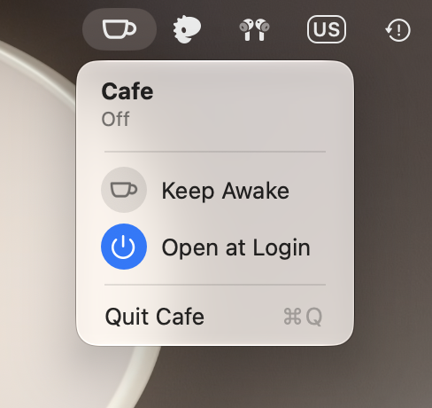
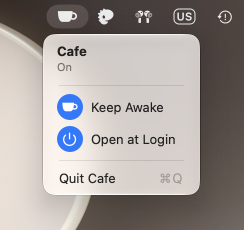

# Cafe

A menu bar toggle that keeps a Mac awake, like `caffeinate -s`.

 

Click the cup and choose Keep Awake to turn it on: the icon fills in and the system won't sleep while on AC power (the display can still sleep). Choose it again to turn it off. Right-click the cup to toggle it without opening the menu. It always starts off.

## Install

```sh
brew install --cask arzezak/tap/cafe
```

## Build

Cafe is built with Xcode, from a project generated by [XcodeGen](https://github.com/yonaskolb/XcodeGen):

```sh
xcodegen generate
xcodebuild -project Cafe.xcodeproj -scheme Cafe build
```

Or open `Cafe.xcodeproj` and run it. Signing uses the team set in `project.yml`; change `DEVELOPMENT_TEAM` to your own.

To start Cafe at login, turn on Open at Login in its menu.
