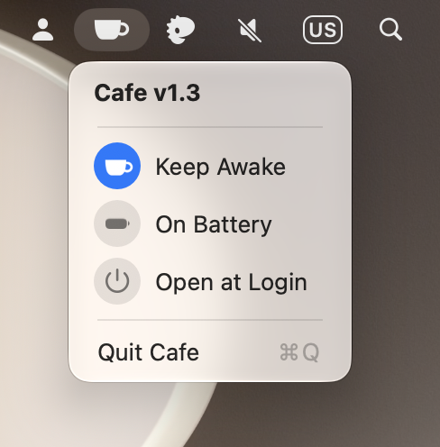

# Cafe

A menu bar toggle that keeps a Mac awake, like `caffeinate -s`.



Click the cup and choose Keep Awake to turn it on: the icon fills in and the Mac stays awake while it's plugged in. Choose it again to turn it off. Right-click the cup to toggle it without opening the menu. It remembers its state the next time it opens.

## Behavior

Cafe keeps the Mac awake on AC power only. On battery the cup stays on, but the Mac sleeps as usual, including when you close the lid, and Cafe takes effect again when you plug back in.

The display sleeps on its own schedule either way, and Apple menu → Sleep always works.

## Install

```sh
brew install --cask arzezak/tap/cafe
```

## Build

Cafe is built with Xcode, from a project generated by [XcodeGen](https://github.com/yonaskolb/XcodeGen):

```sh
xcodegen generate
xcodebuild -project Cafe.xcodeproj -scheme Cafe build
```

Or open `Cafe.xcodeproj` and run it. Signing uses the team set in `project.yml`; change `DEVELOPMENT_TEAM` to your own.

To start Cafe at login, turn on Open at Login in its menu.
